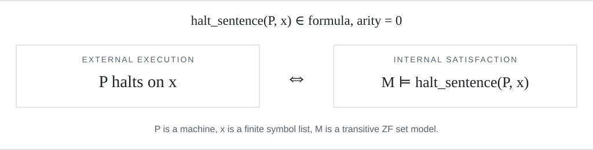

<h1 align="center">Set-Coded Turing Machines</h1>

<p align="center"><strong>Machine execution and internal truth in Isabelle/ZF</strong></p>

<p align="center">
  <a href="https://github.com/anguuananguuan-droid/set-coded-computation-zf/actions/workflows/isabelle.yml"></a>
  <a href="https://isabelle.in.tum.de/website-Isabelle2025-2/"></a>
  <a href="LICENSE"></a>
</p>

<p align="center">
  <a href="papers/Research_Summary.pdf">Research summary</a> &nbsp;·&nbsp;
  <a href="papers/library/Set_Coded_Turing_Machines_Outline.pdf">Proof outline</a> &nbsp;·&nbsp;
  <a href="papers/library/Set_Coded_Turing_Machines.pdf">Full proof</a> &nbsp;·&nbsp;
  <a href="documentation/COMPUTATION.md">Library guide</a> &nbsp;·&nbsp;
  <a href="papers/EPQ_Production_Log.pdf">EPQ log</a>
</p>

A formal library connecting **Turing-machine execution** with **first-order
satisfaction in models of set theory**. Machines, finite runs, formulas,
and their natural-number codes are defined in Isabelle/ZF.

<picture>
  <source media="(prefers-color-scheme: dark)" srcset=".github/assets/halting-interface-dark.svg">
  
</picture>

## 1 Library

The library constructs `halt_sentence(P,x)` and proves the equivalence
above for every transitive ZF set model. The sentence is independent of
the model. The theorem assumes a model satisfying these conditions and
does not assert that one exists.

| Interface | Verified result |
| --- | --- |
| [Execution](thys/Set_Coded_Turing_Machines/Turing_Machine.thy) | Finite runs, execution witnesses, and halting and nonhalting rules |
| [Tape observations](thys/Set_Coded_Turing_Machines/Turing_Tape.thy) | Blank-padding equivalence preserves execution and halting |
| [Machine codes](thys/Set_Coded_Turing_Machines/Turing_Coding.thy) | Natural-number encoding, decoding, and canonical codes |
| [Halting sentences](thys/Set_Coded_Turing_Machines/Turing_Halting_Sentences.thy#L192) | Closed formulas agree with external halting in transitive ZF models |
| [Sentence codes](thys/Set_Coded_Turing_Machines/Turing_Halting_Codes.thy#L34) | Primitive-recursive construction of the exact sentence code for a machine code and unary input |

## 2 Use

Import the interfaces needed by a client. This example transfers the
correctness of a scanning program to truth inside a model.

```isabelle
theory Library_Use
  imports "Set_Coded_Turing_Machines.Turing_Examples"
    "Set_Coded_Turing_Machines.Turing_Halting_Sentences"
begin

theorem scan_append_in_model:
  assumes model: "transitive_zf_model(A)" and n: "n ∈ nat"
  shows "(A, [] ⊨ halt_sentence(scan_append_machine,numeral_input(n)))"
  using sats_halt_sentence_iff[OF model scan_append_machine_type
      numeral_input_type[OF n]] scan_append_halts[OF n] by simp

end
```

The [library guide](documentation/COMPUTATION.md) gives the client session,
machine conventions, and proof interfaces.
[Worked examples](thys/Set_Coded_Turing_Machines/Turing_Halting_Examples.thy)
continue through tape equivalence and numerical sentence codes.

## 3 Build

The checked environment is **Isabelle2025-2** with
[AFP 2026-10-06](https://isa-afp.org/release/afp-2026-10-06.tar.gz).
From the repository root, with Isabelle on the executable search path, run

```sh
isabelle components -u /absolute/path/to/afp-2026-10-06/thys
isabelle build -d . Set_Coded_Turing_Machines
```

The session uses the model interfaces supplied by `Independence_CH`.
Its halting theorem has no CH independence or choice premise.
[Build instructions](documentation/BUILD.txt) cover the independent
ZF computation fragment, proof documents, and exported archive checks.

## 4 Project

| Location | Purpose |
| --- | --- |
| [Library](thys/Set_Coded_Turing_Machines) | Seventeen theories forming the standalone AFP candidate |
| [Research](thys/Research) | Separate applications to computability and model invariance |
| [Papers](papers/README.md) | Research summary, formal proof documents, and the original EPQ |
| [Documentation](documentation/README.md) | User guides, scope, development records, and verification evidence |

The machine design follows
[Universal Turing Machine](https://isa-afp.org/entries/Universal_Turing_Machine.html).
Model closure and satisfaction build on
[Transitive Models](https://isa-afp.org/entries/Transitive_Models.html)
and [Independence_CH](https://isa-afp.org/entries/Independence_CH.html).
The library supplies the connection between these model interfaces and
explicit machine execution. It has not been submitted to AFP.

Maintained by **Tang Ziyi**.
[BSD 3-Clause](LICENSE) · [Citation](CITATION.cff) ·
[Verification record](documentation/records/RV.011.txt) ·
[Contributing](CONTRIBUTING.txt) ·
[Issues](https://github.com/anguuananguuan-droid/set-coded-computation-zf/issues)
